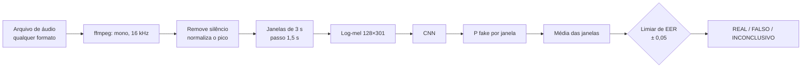

# Detector de voz deepfake em PT-BR com CNN

[](https://colab.research.google.com/drive/1HmQv9uw1JC9kW3rhcQowu-Fl1CJYyXn0)


[](LICENSE)

Rede neural convolucional (Keras/TensorFlow) que recebe **qualquer arquivo de áudio** (mp3, wav, ogg/opus do WhatsApp, m4a, mpeg…) e diz se a voz é **REAL**, **FALSA** (sintética: ElevenLabs, TTS em geral) ou **INCONCLUSIVA**.

Projeto final da disciplina de Aprendizado Profundo (*Deep Learning*) da UTFPR, Campus Curitiba, 2026.

## Conteúdo do repositório

| Item | Onde |
|---|---|
| Código-fonte | [`deepfake_voz_ptbr_cnn.py`](deepfake_voz_ptbr_cnn.py): cada bloco `# %%` é uma célula do Colab |
| Notebook do Colab | [`deepfake_voz_ptbr_cnn.ipynb`](deepfake_voz_ptbr_cnn.ipynb), gerado a partir do `.py` por [`ferramentas/gerar_notebook.py`](ferramentas/gerar_notebook.py) |
| Bases de dados | Todas públicas e baixadas pelo código. Lista e links em [Bases de dados](#bases-de-dados) |
| Link do Colab | https://colab.research.google.com/drive/1HmQv9uw1JC9kW3rhcQowu-Fl1CJYyXn0 |
| Artigo (Overleaf) | [`documentacao/artigo_deepfake_voz.tex`](documentacao/artigo_deepfake_voz.tex): template JBCS/SBC; cole no projeto do template, envie a pasta [`documentacao/figuras/`](documentacao/figuras) (gráficos do Colab) e compile com XeLaTeX |
| Integrantes | Carlos Eduardo Rosa Portella ([@carlosportella16](https://github.com/carlosportella16)) e Felipe Pereira da Silva ([@fepersilva](https://github.com/fepersilva)) |
| Dependências | [`requirements.txt`](requirements.txt): versões fixadas para o Mac (Apple Silicon) |
| Versão completa | [`versao_completa/deepfake_voz_ptbr_cnn_completo.py`](versao_completa/deepfake_voz_ptbr_cnn_completo.py): o código antes de enxugar, com os experimentos desligados (CNN14, adaptação, comparações de arquitetura, entrada, precisão e robustez). Só referência; não faz parte da entrega |

### Como executar

**Colab:** suba o `deepfake_voz_ptbr_cnn.ipynb` no Drive e abra com o Colab. Depois, *Ambiente de execução → Alterar tipo → GPU*, cadastre o token do Hugging Face em *Secrets* como `HF_TOKEN` (com os termos do MLAAD aceitos na mesma conta) e rode as células em ordem. Coloque os áudios do grupo em `projeto_deepfake_audio/teste_cego/{fake,original}/` no Drive.

**Mac (Apple Silicon):**

```bash
/opt/homebrew/bin/python3.12 -m venv .venv312
.venv312/bin/pip install -r requirements.txt
.venv312/bin/hf auth login                      # token "Read" do Hugging Face
MPLBACKEND=Agg .venv312/bin/python deepfake_voz_ptbr_cnn.py
```

O `.py` é a fonte única. Depois de alterá-lo, regenere o notebook com `.venv312/bin/python ferramentas/gerar_notebook.py`; `--checar` diz se o notebook está desatualizado.

A primeira execução baixa/gera os dados e guarda as características em `projeto_deepfake_audio/cache_v8_*.npz`; as seguintes só leem o cache. Para **só classificar** áudios com um modelo já treinado, rode apenas a seção 9 (independente): ela lê o modelo, o limiar e o pré-processamento do `resultados.json`.

### Seções do código

| Seção | Conteúdo |
|---|---|
| 0 | Configuração (todas as constantes ajustáveis), ambiente, GPU, Drive |
| 1 | Pré-processamento: janelas de 3 s, log-mel, degradações de canal (codecs, reenvio pelo WhatsApp, ruído, eco, telefone) |
| 2 | Coleta: fontes reais e falsas, divisão sem vazamento, cache paralelo |
| 3 | CNN residual, SpecAugment, pipeline de lotes, treino |
| 4 | Comparação opcional de ativações e otimizadores (desligada; já rodada) |
| 5 | Treino final (ensemble de 2 residuais) |
| 6 | Avaliação: teste limpo, degradado, generalização, In-the-Wild, limiar de operação |
| 7 | **Teste cego** com os áudios do grupo e teste de formato |
| 8 | Resultados consolidados (`resultados.json`) |
| 9 | Classificador independente (sessão nova, sem treinar) |

## Resultados

Modelo atual: **ensemble de 2 CNNs residuais** (sementes diferentes; P(fake) = média das duas). Cada uma tem 4 blocos residuais, 32-64-96-128 filtros, 501 953 parâmetros, sobre log-mel 128×301. Treino com 8000 áudios (4000 por classe), cada um em 3 versões, até 80 épocas (melhores épocas: 71 e 58). O treino leva ~4,8 h num Mac mini M4 (149 + 137 min).

| Conjunto | AUC | EER |
|---|---|---|
| Teste limpo | 0,995 | 3,25% |
| Teste degradado (codec, reenvio pelo WhatsApp, ruído, eco, telefone) | 0,988 | **4,9%** |
| Generalização (TTS nunca vistos: OpenAI TTS-1 HD, Voxtral, Qwen3-TTS 1.7B) | 0,997 | 2,5% |
| Generalização degradada | 0,974 | 7,25% |
| In-the-Wild (figuras públicas, internet, inglês; só avaliação) | 0,789 | 28,8% |
| **Teste cego** (áudios do grupo, nunca usados no treino) | — | **13/16 falsos, 9/9 reais** (1 inconclusivo) |

**EER** (*equal error rate*): taxa de erro no ponto em que "real marcado como falso" = "falso aceito como real". Quanto menor, melhor.

### Evolução

| Versão | EER limpo | EER degradado | EER generalização | Teste cego (falsos / reais) |
|---|---|---|---|---|
| 1ª execução completa (LFCC + BRSpeech-DF) | 28,3% | 30,4% | 14,5% | 7/16 / 4/9 |
| Mel, sem BRSpeech-DF, 40 épocas | 4,1% | 14,1% | 10,3% | 12/16 / 9/9 |
| + 3 versões por áudio e cadeia WhatsApp, 80 épocas | 2,5% | 7,4% | 5,8% | 12/16 / 9/9 |
| + dados ampliados (8000 áudios, MLAAD em 5 idiomas, In-the-Wild) | 3,5% | 6,5% | 4,0% | 13/16 / 9/9 |
| + arquitetura residual e correção do defeito do Metal | **2,9%** | 5,4% | 3,0% | 13/16 / 9/9 |
| + **ensemble de 2 residuais** (atual) | 3,25% | **4,9%** | **2,5%** | **13/16 / 9/9** |

Os testes mudaram ao longo das versões (o degradado ganhou o reenvio pelo WhatsApp; os dados ampliados trouxeram testes novos e maiores), então cada linha só é comparável com a anterior no mesmo teste. As linhas antes da última foram treinadas com o defeito do tensorflow-metal (decisão 22).

**Metas** (design inicial): EER degradado ≤ 10% ✅ · generalização ≤ 20% ✅ · no teste cego, no máx. 1 real errado ✅ e ≥ 80% dos falsos ✅ (13/16 = 81%). Ainda escapam: a voz "Lucas" do ElevenLabs (P(fake) = 0,431, inconclusiva, abaixo do limiar de 0,475) e dois falsos de origem desconhecida reenviados pelo WhatsApp (0,13 e 0,07).

### Experimentos que não viraram padrão

| Experimento | Resultado | Por que ficou de fora (código em `versao_completa/`) |
|---|---|---|
| CNN14 pré-treinada (PANNs), congelada + cabeça | EER 9,9% / 20,4% / 14,3% (limpo / degradado / generalização); teste cego 13/16 e 9/9 | perdeu da CNN do zero nos dois critérios da regra de adoção |
| Adaptação com os áudios do grupo (validação cruzada por voz, 4 partes) | teste cego 14/16 e 9/9; EER degradado 5,9% (base 5,4%) | ganho de 1 arquivo com só 16 vozes; piora um pouco os testes públicos |
| Ensemble de 3 modelos | não treinado no Mac (3 residuais ≈ 7,5 h) | o de 2 já passou na regra (decisão 25); 3 fica opcional no Colab (`N_MODELOS_ENSEMBLE = 3`) |

## Bases de dados

Todas são públicas e baixadas automaticamente pelo código.

| Base | Uso | Link |
|---|---|---|
| BRSpeech-DF | Avaliada e **descartada**: os falsos clonam os mesmos locutores dos reais e confundiam o treino. Não é usada no código entregue | https://huggingface.co/datasets/AKCIT-Deepfake/BRSpeech-DF |
| MLAAD (CC BY-NC 4.0) | Falsos de 16 TTS em português (3 reservados só para o teste de generalização) e, em 20% dos falsos, de geradores de outros idiomas (en, es, de, fr, it) que não existem no pt, entre eles ElevenLabs v2/v3/Turbo, Cartesia, MiniMax e Bark. Exige aceitar os termos | https://huggingface.co/datasets/mueller91/MLAAD |
| CORAA-MUPE | Reais: entrevistas em PT-BR | https://huggingface.co/datasets/nilc-nlp/CORAA-MUPE-ASR |
| Common Voice 17 (CC0) | Reais: voluntários gravando em celular/notebook, em português e nos mesmos idiomas dos falsos estrangeiros (na mesma proporção, para o idioma não denunciar a classe); também fornece as frases lidas pelo edge-tts e pelo gTTS | https://huggingface.co/datasets/fixie-ai/common_voice_17_0 |
| In-the-Wild (CC BY-SA 4.0) | **Só avaliação** (nunca entra no treino nem no limiar): 400 falsos e 400 reais de figuras públicas, coletados da internet (inglês). Lidos direto do ZIP, sem baixar os 7,6 GB | https://huggingface.co/datasets/mueller91/In-The-Wild |
| Deepfake Audio Detection (CC BY 4.0) | Falsos comerciais (ElevenLabs, Amazon Polly, Speechify, Hume AI, Luvvoice, Kokoro) e reais do YouTube, em inglês | https://huggingface.co/datasets/garystafford/deepfake-audio-detection |
| Microsoft edge-tts | Falsos comerciais gerados pelo código (vozes neurais pt-BR e pt-PT) | https://github.com/rany2/edge-tts |
| Google gTTS | Falsos comerciais gerados pelo código (pt-BR e pt-PT) | https://github.com/pndurette/gTTS |

## Técnicas e algoritmos

Valores do modelo padrão (constantes da seção 0 e funções das seções 1, 3 e 6).

### Visão geral do pipeline



No treino, entre as etapas D e E entram o **aumento de dados** e as **proteções contra atalhos** (abaixo).

### Pré-processamento do áudio

| Etapa | Algoritmo e parâmetros |
|---|---|
| Decodificação | `ffmpeg` (aceita mp3, wav, ogg/opus, m4a, aac, flac, webm, mp4, mpeg) → mono, 16 kHz, float32 |
| Reamostragem | `librosa.resample` quando a taxa original é outra |
| Remoção de silêncio | `librosa.effects.trim`, limiar de 35 dB abaixo do pico, só nas pontas |
| Normalização | pico em 0,95 (amplitude) |
| Duração mínima | 1 s de fala; abaixo disso, o arquivo é rejeitado com aviso |
| Janelamento | trechos de 3 s (48 000 amostras), passo de 1,5 s, cobrindo o áudio todo; áudio curto é repetido até 3 s (não preenchido com silêncio) |
| **Log-mel** (padrão) | STFT com janela de Hann de 1024 pontos e passo de 160 (10 ms) → 128 filtros mel de 20 Hz a 8 kHz → potência em dB (`power_to_db`, referência no máximo, faixa de 80 dB) → escala [0, 1]. Saída: 128 × 301 |
| LFCC (alternativa, versão completa) | STFT de 512 pontos → 60 filtros triangulares **lineares** → log → DCT tipo II (20 coeficientes) + Δ + ΔΔ → padronização por linha. Saída: 60 × 301 |
| Mel + LFCC (alternativa, versão completa) | o LFCC é redimensionado para 128 × 301 por interpolação linear e empilhado ao mel: 2 canais |

### Aumento de dados e proteções contra atalhos

Tudo é sorteado **sem olhar o rótulo**, com a mesma probabilidade para reais e falsos.

| Técnica | Detalhe |
|---|---|
| Recorte aleatório | trecho de 3 s em posição sorteada; cada áudio de treino tem **3 versões** independentes, e uma é sorteada a cada época |
| Codec com perdas (p = 0,7) | ida e volta pelo `ffmpeg`: MP3 (24–128 kbps), Opus (12–32 kbps) ou AAC (32–128 kbps) |
| Reenvio pelo WhatsApp (25% dos codecs) | Opus 16–32 kbps → MP3 ou AAC a 24 kHz, 32–64 kbps → normalização |
| Degradações de canal (p = 0,5; 1 ou 2 por trecho) | telefone (8 kHz, passa-faixa 300–3400 Hz, Butterworth de 4ª ordem); ruído branco com SNR de 10–35 dB; reverberação sintética (RT60 de 0,15–0,6 s, mistura de 20–60%); passa-baixa (Butterworth de 6ª ordem, corte de 3,5–7,5 kHz); equalização aleatória (FIR de 129 coeficientes, ±6 dB, graves cortados) |
| Ruído de fundo emprestado (p = 0,7) | o piso de ruído (percentil 10 da energia RMS em quadros de 25 ms) de um real sorteado é aplicado ao falso com ruído branco ou rosa |
| **SpecAugment** (na GPU, só no treino) | zera uma faixa de até 12 bandas de frequência e uma de até 30 quadros (0,3 s) de tempo, diferente para cada amostra |

### Arquitetura da CNN (residual)

| Camada | Configuração | Saída |
|---|---|---|
| Entrada | log-mel | 128 × 301 × 1 |
| Bloco residual 1 | Conv2D 3×3 (32 filtros, sem bias) → BatchNorm → **ReLU** → Conv2D 3×3 → BatchNorm, somado ao atalho (Conv2D 1×1 + BatchNorm, porque muda o nº de canais) → ReLU → MaxPooling 2×2 → SpatialDropout 10% | 64 × 150 × 32 |
| Bloco residual 2 | igual, 64 filtros | 32 × 75 × 64 |
| Bloco residual 3 | igual, 96 filtros | 16 × 37 × 96 |
| Bloco residual 4 | igual, 128 filtros | 8 × 18 × 128 |
| Pooling global | **GlobalAveragePooling** (média) ‖ **GlobalMaxPooling** (pico), concatenados | 256 |
| Densa | Dense(64) com regularização **L2** (1e-4) → ReLU → **Dropout** 40% | 64 |
| Saída | Dense(1) com **sigmoide** → P(fake) entre 0 e 1 | 1 |

Total: **501 953 parâmetros**. Convoluções com `padding="same"`; BatchNorm com momento 0,9; pesos iniciados com o padrão do Keras (Glorot uniforme). O atalho deixa o gradiente passar direto pelos blocos, o que permite mais filtros sem piorar o treino. O pooling de máximo pega artefatos de síntese localizados, que a média diluiria. A ReLU é implementada como `LeakyReLU(negative_slope=0)`, matematicamente idêntica (decisão 22).

**Alternativas comparadas** (o código das que perderam ficou em `versao_completa/`):

| Opção | O que muda |
|---|---|
| `"original"` | 4 blocos simples [Conv 3×3 → BatchNorm → ReLU] × 2 → MaxPooling, 16-32-64-64 filtros; 155 025 parâmetros (o padrão até a comparação) |
| `"leve"` | igual à original, com 1 convolução no 1º bloco (~22% menos cálculo) |
| `"lcnn"` | Light CNN do ASVspoof: ativação **Max-Feature-Map** (convolução com o dobro de filtros; fica o máximo entre as duas metades) no lugar da ReLU; 300 321 parâmetros |
| `POOLING = "atencao"` | média ponderada no tempo, com um peso por quadro (Dense + **softmax**), no lugar da média simples |
| Ensemble (padrão, `N_MODELOS_ENSEMBLE = 2`) | N modelos iguais com sementes diferentes; P(fake) = média das saídas |
| CNN14 / PANNs | CNN de 6 blocos (64→2048 filtros, AvgPool) pré-treinada no AudioSet, congelada, com uma cabeça Dense(256, ReLU) → Dense(1, sigmoide) |

### Treino

| Item | Escolha |
|---|---|
| Função de perda | **Entropia cruzada binária** com *label smoothing* de 0,05 (rótulos 0,025 / 0,975) |
| Otimizador | **AdamW** (Adam com *weight decay* desacoplado de 1e-4) |
| Taxa de aprendizado | aquecimento linear na 1ª época até 1,5e-3, depois **decaimento cosseno** até 2% do pico |
| Lote / épocas | 64 amostras (128 no Colab) / até 80 épocas |
| Parada antecipada | `EarlyStopping` pela perda de validação, paciência de 15 épocas, restaurando os melhores pesos |
| Validação | conjunto limpo + o mesmo conjunto degradado (a parada premia a robustez) |
| Regularização | BatchNorm, SpatialDropout (10%), Dropout (40%), L2 (1e-4), *weight decay*, *label smoothing*, SpecAugment e aumento de dados |
| Pipeline | `tf.data`: índices embaralhados a cada época, lote montado com `tf.gather`, `prefetch` |
| Precisão | float32 no Mac (Metal); `mixed_float16` + XLA só em GPU NVIDIA |
| Reprodutibilidade | semente 42 (`tf.keras.utils.set_random_seed`); divisão dos arquivos por hash MD5 do nome |

**Comparação de ativações e otimizadores** (seção 4, `COMPARAR_CONFIGURACOES`): ReLU, LeakyReLU (α = 0,1) e ELU; Adam, SGD com momento de Nesterov (0,9) e RMSprop. Venceu **ReLU + Adam** (menor perda de validação), usado com *weight decay* (AdamW).

### Avaliação e decisão

| Item | Como é calculado |
|---|---|
| **AUC** | área sob a curva ROC (`roc_auc_score`) |
| **EER** | ponto da curva ROC em que a taxa de falso positivo = taxa de falso negativo |
| Acurácia, precisão, recall, F1 | `classification_report` (scikit-learn), por classe e média macro, no limiar 0,5 |
| Matriz de confusão | `confusion_matrix`, com gráfico |
| Por gerador / por fonte | taxa de acerto de cada TTS e taxa de falso alarme de cada fonte real |
| **Limiar de operação** | o limiar do EER na validação (limpa + degradada); salvo no `resultados.json` |
| Faixa INCONCLUSIVA | P(fake) a menos de 0,05 do limiar |
| Decisão do arquivo | P(fake) do arquivo = média das P(fake) das janelas |
| Confiança exibida | 0,5 + 0,5 × distância ao limiar ÷ distância máxima possível daquele lado (50–100%) |
| Teste de formato | o mesmo áudio real em WAV, MP3 e Ogg/Opus; registra a maior diferença de P(fake) |

### Bibliotecas

TensorFlow/Keras 2.18 (+ tensorflow-metal), librosa (áudio, mel, STFT), SciPy (filtros, DCT, convolução), NumPy, pandas, scikit-learn (métricas), matplotlib/seaborn (gráficos), soundfile e ffmpeg (decodificação e codecs), Hugging Face `datasets`/`huggingface_hub` (bases), pyarrow (parquet), edge-tts e gTTS (geração de falsos comerciais). PyTorch é usado só para converter os pesos da CNN14 (opcional).

## Decisões

Cada decisão foi medida com os mesmos dados antes de entrar.

### Modelo e entrada

1. **CNN pura em Keras, treinada do zero.** Escolha do grupo. Modelos pré-treinados de fala (wav2vec2, WavLM) ficaram fora. A CNN14 pré-treinada foi só um experimento de comparação (decisão 21), que só substituiria a CNN do zero se ganhasse no teste degradado **e** na generalização.
2. **16 kHz, janelas de 3 s com passo de 1,5 s.** Acima de 8 kHz os codecs cortam de forma diferente (Opus ~12 kHz, ElevenLabs ~15 kHz): usar essa faixa daria um atalho pela largura de banda. A decisão do arquivo usa todas as janelas.
3. **Log-mel 128×301, não LFCC.** A hipótese inicial (LFCC, padrão do ASVspoof) perdeu nos mesmos dados: EER degradado de 12,6% (mel) contra 18,5% (LFCC); teste cego com 15/16 contra 10/16 falsos. O código do LFCC ficou na versão completa.
4. **Arquitetura residual**, escolhida numa comparação com os mesmos dados (20 épocas cada) em que o padrão só mudaria com ganho de 0,5 ponto ou mais no teste degradado:

   | Arquitetura | Pooling | Entrada | Parâmetros | s/época | EER degradado | EER generalização |
   |---|---|---|---|---|---|---|
   | original | média+máx | mel | 155 025 | 38,6 | 12,5% | 5,0% |
   | **residual** | média+máx | mel | 501 953 | 111,6 | **9,5%** | 5,0% |
   | lcnn | média+máx | mel | 300 321 | 58,9 | 11,25% | 4,75% |
   | original | atenção | mel | 155 090 | 39,6 | 11,75% | 5,75% |
   | original | média+máx | mel+lfcc | 155 169 | 40,5 | 13,6% | 4,75% |

   A residual ganhou 3 pontos no degradado, ao custo de ~2,9× o tempo por época. Pooling por atenção e entrada mel+LFCC não compensaram. O número de modelos do ensemble foi decidido depois, numa rodada própria (decisão 25).
5. **Agregação das janelas fixa** (média das probabilidades). Não há validação com vários trechos por arquivo para escolher; o teste cego relata também a média dos logits, só como informação.

### Dados

6. **Falsos comerciais no treino** (a causa original do problema: o modelo nunca tinha visto vozes como as do ElevenLabs): edge-tts (Microsoft, 2500 áudios pt-BR/pt-PT), gTTS e o dataset público com ElevenLabs, Polly, Speechify, Hume, Luvvoice e Kokoro.
7. **BRSpeech-DF desligado.** Os falsos dele clonam os mesmos locutores dos reais e confundiam o treino: tirá-lo levou o EER limpo de 28,2% para 9,2% e o degradado de 30,4% para 18,5%.
8. **Idioma não pode denunciar a classe.** Falsos em inglês (comerciais) e em outros idiomas (MLAAD en/es/de/fr/it, 20% dos falsos, com ElevenLabs v2/v3/Turbo, Cartesia, MiniMax…) entram com reais dos **mesmos idiomas na mesma proporção**; um `assert` exige no máx. 5 pontos de diferença por idioma.
9. **Repasse de vagas:** a cota que um gerador pequeno não preenche vai para os que têm clipes (antes faltavam 35% dos falsos comerciais). O Bark, o menos detectado (44%), tem cota dobrada.
10. **Separação sem vazamento:** divisão fixa por arquivo (hash), 3 geradores reservados só para a generalização (em qualquer idioma), áudios do grupo **nunca** no treino nem no limiar. O In-the-Wild (internet) é só avaliação.

### Contra atalhos e robustez

11. **Codec aleatório nas duas classes**, no lugar do MP3 fixo da versão anterior (que apagava detalhes de todas as amostras). O teste de formato confirma: o mesmo áudio em WAV/MP3/OGG muda P(fake) em ≤ 0,003.
12. **Ruído de fundo emprestado:** os falsos recebem o nível de ruído dos reais, para "silêncio = falso" não virar pista.
13. **3 versões de cada áudio, sorteadas a cada época**, cada uma com recorte, codec e degradação próprios, e uma **cadeia de reenvio pelo WhatsApp** (Opus → MP3/AAC 24 kHz) nas duas classes. Antes, o modelo via a mesma versão degradada nas 40 épocas e decorava. Ganho: EER degradado 13,3% → 7,4% no mesmo teste.
14. **Mixup desligado:** piorou o teste degradado na comparação (16,4% → 17,8%). O label smoothing (0,05) e o SpecAugment continuam.
15. **80 épocas, paciência 15:** com 40, o treino terminava ainda melhorando (a melhor época foi a 65).

### Decisão e classificação

16. **Limiar no ponto de EER da validação** (limpa + degradada), com faixa INCONCLUSIVA de ±0,05. O limiar anterior (no máx. 5% de reais marcados, mínimo 0,5) favorecia chamar falsos de REAL.
17. **Teste cego do modelo base é a métrica oficial.** A adaptação com os áudios do grupo (versão completa) usou validação cruzada **agrupada por voz** (nenhuma voz no treino e no teste ao mesmo tempo) e recodifica as duas classes igualmente (os reais do grupo são todos .ogg e os falsos .mp3). O classificador usa só o modelo base.

### Ambiente e desempenho

18. **TensorFlow 2.18.1 + tensorflow-metal 1.2.0** (o 2.21 não carrega o plugin Metal), numpy 2.0.2.
19. **O gargalo é a GPU**, não os dados (mesmo tempo com lote fixo na GPU). O pipeline `tf.data` ficou (sem laço Python), mas o ganho foi de só 0,7%.
20. **Precisão mista desligada no Mac:** 14% mais lenta e +1,6 ponto de EER no Metal; trocar de política no mesmo processo derruba o Python. No Colab (CUDA) ela liga sozinha, com lote 128. Corrigido também um bug que a desligava no Colab (`clear_session()` apagava a política).

### Validação e limites

21. **CNN14 (PANNs) só como comparação.** Reimplementada em Keras, com os pesos oficiais convertidos (diferença máxima de 5e-6 para o original). Congelada, ficou bem atrás da CNN do zero (EER degradado 20,4% contra 5,4%). Ficou fora do código entregue (está na versão completa).
22. **Defeito do tensorflow-metal 1.2.0 contornado.** No modo grafo (`fit`/`predict`), a sequência Dense → bias → ReLU devolve valores errados na GPU do Mac (erro de até 1,8 numa Dense 128→64; até 0,099 na P(fake) do modelo final). Sigmoide, ELU, LeakyReLU e as convoluções não são afetadas. A ReLU passou a ser `LeakyReLU(negative_slope=0)`, idêntica na matemática; depois disso, `predict` e o cálculo direto dão a mesma saída em todas as arquiteturas. Os modelos treinados antes da correção tinham probabilidades distorcidas; os números da comparação de arquiteturas e do modelo atual já são da versão corrigida.
23. **In-the-Wild é a limitação conhecida.** Em áudios de figuras públicas coletados da internet (inglês, muito ruído, música, gravações antigas), o EER é de 28,8% (AUC 0,79; com 1 modelo, 29,5%): o modelo foi treinado com fala lida/TTS e não com esse tipo de áudio. A base fica só para avaliação, para medir a distância até o "mundo real".
24. **Adaptação medida de forma honesta.** O modelo adaptado com todos os áudios do grupo acerta 16/16 e 9/9 neles, mas isso não vale como teste (ele viu esses arquivos). O número válido é o da validação cruzada por voz: 14/16 e 9/9.
25. **Ensemble de 2 residuais adotado** pela regra fixada antes da rodada (≥ 0,5 ponto a menos de EER degradado e teste cego no mínimo igual). Mesmos dados e testes; a 2ª semente (43) treinou 73 épocas (melhor: 58).

    | Modelo | EER limpo | EER degradado | EER generalização |
    |---|---|---|---|
    | modelo 0 (semente 42, o anterior) | 2,88% | 5,38% | 3,0% |
    | modelo 1 (semente 43) | 2,75% | 6,0% | 2,0% |
    | **ensemble (média)** | 3,25% | **4,88%** | 2,5% |

    Degradado −0,50 ponto, generalização degradada 9,0% → 7,25%, In-the-Wild 29,5% → 28,8%; o limpo piora 0,4 ponto. Teste cego igual (13/16 e 9/9, os mesmos 3 erros). Custo: o treino dobra (~4,8 h no Mac) e a classificação roda 2 redes. Os arquivos são `modelo_cnn_final_s0.keras` e `_s1.keras`, listados em `config.modelos` do JSON; `modelo_cnn_final.keras` é uma cópia do 1º. Para voltar a 1 modelo: `N_MODELOS_ENSEMBLE = 1` (o backup do modelo único está em `projeto_deepfake_audio/backup_residual/`).
26. **Código entregue enxuto.** O `.py` (e o notebook gerado dele) ficou só com o caminho do modelo final: as opções desligadas (CNN14, adaptação, BRSpeech-DF, LFCC, arquiteturas e pooling alternativos, mixup, canal padronizado, comparações de precisão e robustez, diagnóstico de gargalo) saíram, e o arquivo foi de 2551 para ~1700 linhas. A comparação de ativações e otimizadores (seção 4) ficou, desligada. O código anterior está em `versao_completa/`, e os números das decisões acima vêm dele. O nome dos caches não mudou, então o enxugamento não exige coletar de novo; o classificador dá as mesmas P(fake) no teste cego.

## Uso responsável

O detector é um trabalho acadêmico e não deve ser tratado como prova pericial. Um resultado REAL não garante que o áudio seja autêntico, e a faixa INCONCLUSIVA existe para indicar quando a decisão automática não é confiável. Os áudios usados no teste cego foram gravados ou gerados pelos próprios autores e não são distribuídos neste repositório.

## Licença

O código está sob a licença [MIT](LICENSE). As bases de dados não fazem parte do repositório: são baixadas pelo código e seguem as licenças próprias, listadas em [Bases de dados](#bases-de-dados). O MLAAD (CC BY-NC 4.0), por exemplo, só permite uso não comercial, e essa restrição vale para os modelos treinados com ele.
